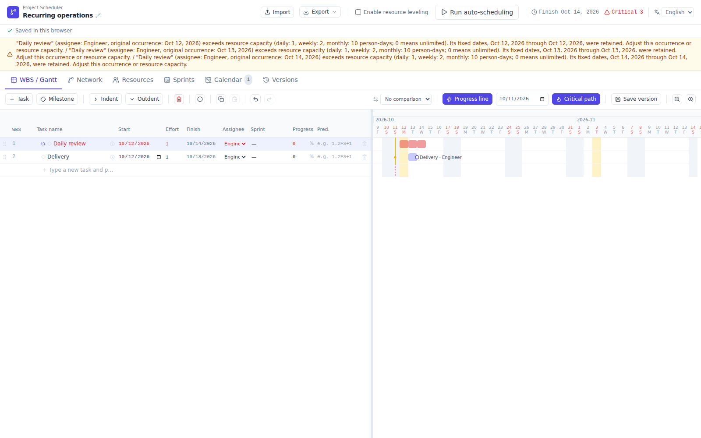
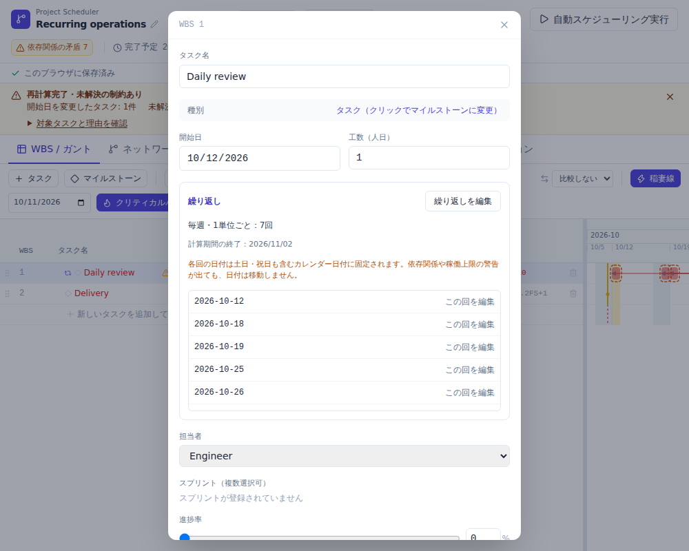
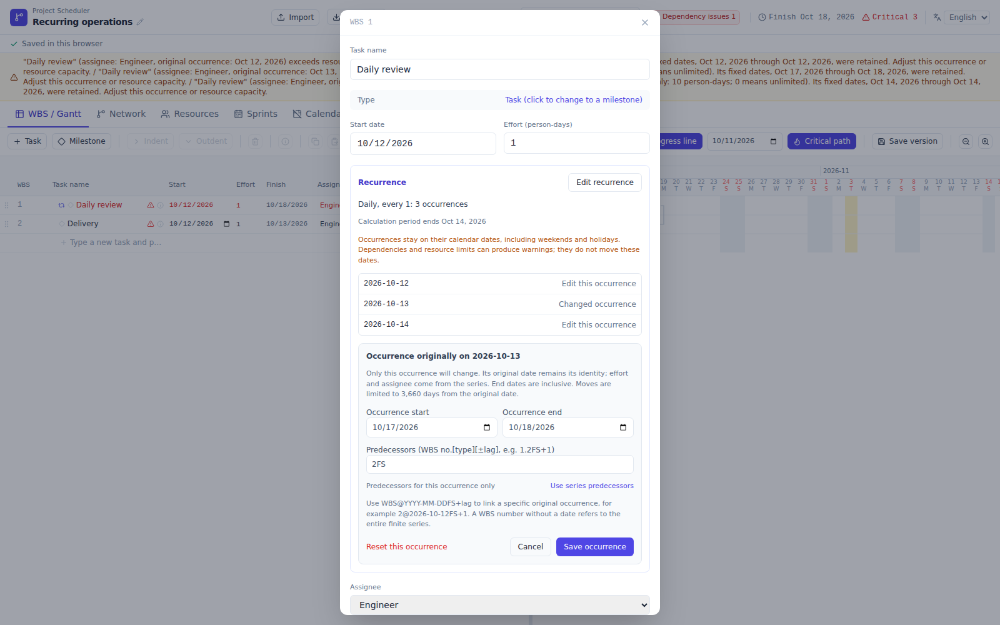
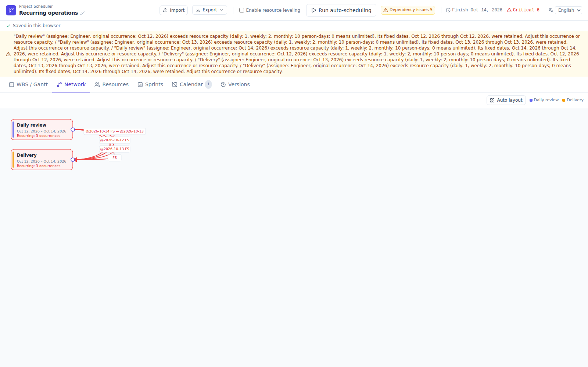
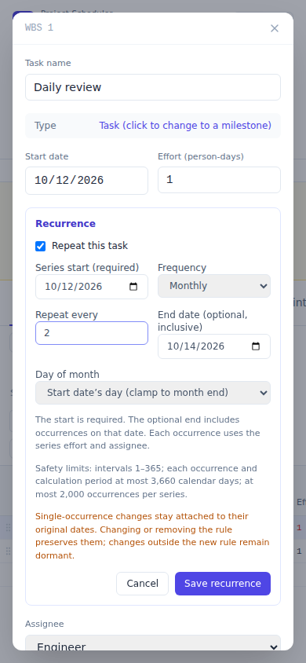
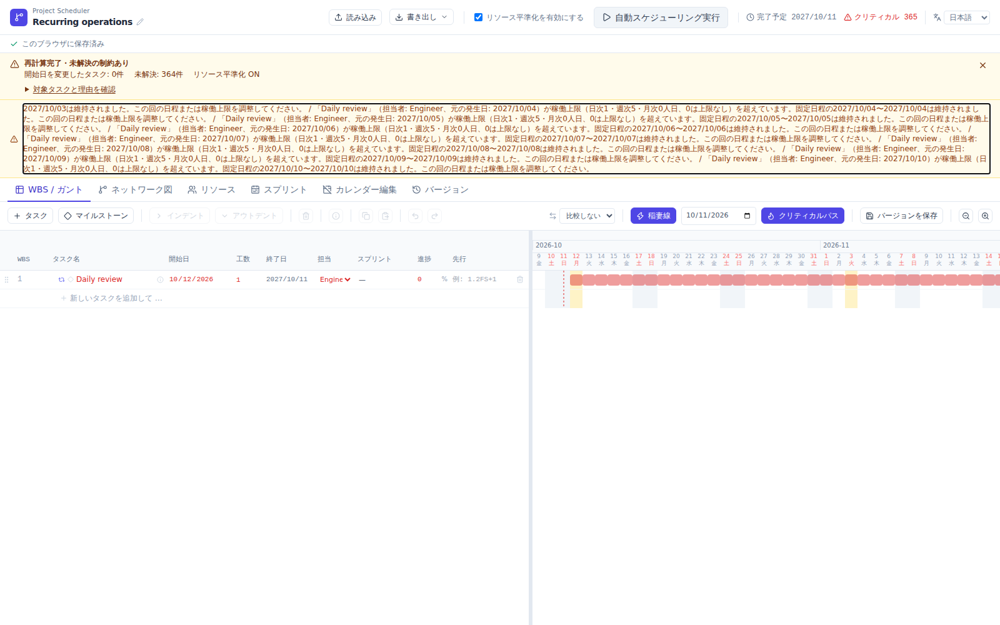
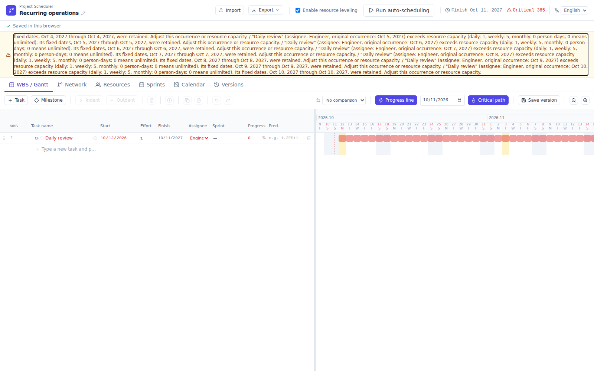

# Issue #60: recurring-task verification

## Verified build

- Source candidate: `7b04ebbd7b2a1ae655f8fe74fa9dcbf625f612e4`
- Standalone HTML SHA-256: `9bd2cdf568c4c210bb35a81cb775cd640eb5a4cfc6709b94d64f808fe38fa14c`
- [CI run](https://github.com/lhideki/project-scheduler/actions/runs/38115321335): 665 unit tests (33 files) and 96 browser tests passed, all on the first attempt at this source head. Build, generated-file consistency and Pages generation also passed. Dependency installation reported zero audit vulnerabilities.
- [Original browser evidence](https://github.com/lhideki/project-scheduler/actions/runs/38115321335/artifacts/11692484352)
- Evidence ZIP SHA-256: `ed51e186e75e73eed721ec939506392a5e7efc60df8506c104f7243235f62513`
- Browser: Chromium 153 on GitHub Actions Ubuntu, Node 24. Local build/test checks used the locked npm dependencies. Local browser execution was unavailable; these are genuine CI browser captures, not mockups.

All images below are unedited screenshots using synthetic data. They were inspected directly after checksum-verifying the artifact. The later evidence-only commit leaves the verified application and tests unchanged.

## Actual screenshots

### One Gantt row, three fixed occurrences

### Japanese details and explicit calculation period

### Individual occurrence dates and dependencies
The original occurrence remains `2026-10-13` after moving to October 17–18. Its predecessor override is `2FS`.

### Separately selectable occurrence dependencies
Parallel connectors are rendered behind their labels, keeping all four labels readable.

### Mobile recurrence controls
At 390×844, the dialog fits within x=16–374 and y=16–828. Its close button, scrollable contents and recurrence actions remain reachable. The browser scenario exercises Cancel, Close and Escape without saving the draft.

### A year of warnings stays scrollable
A daily series with 365 fixed occurrences produces 364 capacity warnings in this fixture. Their complete text remains in a named, keyboard-focusable region capped at 112px (about 125px including its outer spacing). Home/End reaches the first/last text; the WBS and scheduling button remain usable. Calculation and warning contents are unchanged.

## Coverage and visual-reference acceptance

The new recurrence scenarios cover cancellation, invalid input, Undo/Redo, reload, JSON round trips, stable original-date identity, inherited and one-sided date overrides, dormant overrides, dependency edits, fixed scheduling/leveling, viewport invariance, Japanese/English UI, protected TSV/internal-row pastes mobile controls, and a full year of warning scroll/keyboard interactions in both locales. Unit/CLI tests cover month ends, leap dates, interval anchors, deterministic finite horizons, safety truncation, off-screen/moved dependencies, cycles, allocation and backward-compatible persistence.

[Machine-readable comparison and image checksums](verification.json).

All 24 visual comparisons retain their strict geometry/computed-style and zero-non-AA changed-pixel gates. No tolerance relaxation or masking was introduced. The unchanged v3 reference remains in use for 22 scenarios. Only the two intentionally changed task-detail scenarios use the separately documented Issue #60 reference. Non-rendered SVG title/description metadata is excluded from text identity keys; visible text and pixel/style/geometry comparisons remain checked.

The initial matching mobile reference was rejected during visual inspection because the detail dialog was clipped. The overlay was corrected to follow the visual viewport. Fresh mobile screenshots and interaction tests passed before accepting the replacement reference. Matching a newly recorded baseline alone was not treated as visual approval.

## Automated review fixes

- [Codex: preserve implicit dates](https://github.com/lhideki/project-scheduler/pull/61#discussion_r4240315823): dependency-only edits retain absent/start-only/end-only date fields; actual date edits save the complete displayed range. Fixed in `c30d645` with unit and browser regressions.
- [Codex: exclude dormant successors](https://github.com/lhideki/project-scheduler/pull/61#discussion_r4240315826): successor details filter overrides against active generated original dates. Fixed in `c30d645` with regressions.
- [Copilot: actual project end](https://github.com/lhideki/project-scheduler/pull/61#discussion_r4240324253): actual leaf finishes determine project end, including occurrences moved before their origin; only an empty schedule uses the origin fallback. Fixed in `9a9f938` with CPM/CLI regressions.
- [Copilot: atomic paste rejection](https://github.com/lhideki/project-scheduler/pull/61#discussion_r4240324266): protected recurring cells reject the entire paste and consume the event; safety-validation failures also cannot fall through to native editing. Fixed in `9a9f938` with unit/browser regressions.

Independent review also checked the fixes and their App/CLI/Undo/persistence paths. All four review threads were marked resolved after the source CI passed. This records addressed findings, not a claim of separate reviewer approval of the final commit.

## Limits

Native Safari/Firefox and real mobile keyboards were not run. The screenshots establish the tested views, not a universal responsive-layout audit. Unrelated narrow-view clipping already present in the previous application was not redesigned. Recurring dates are calendar-fixed and share effort/assignee/progress; the finite calculation horizon and conversion limitations are documented in [the feature specification](../../recurring-tasks.md).
