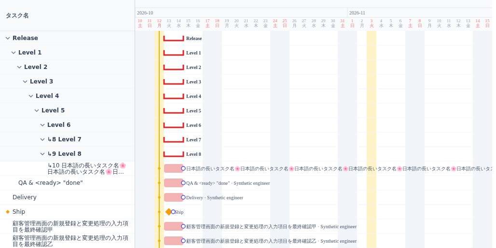
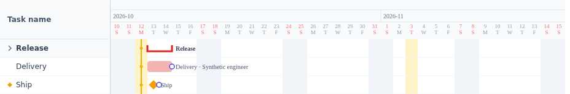
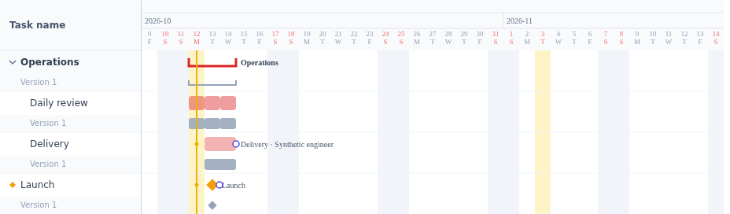
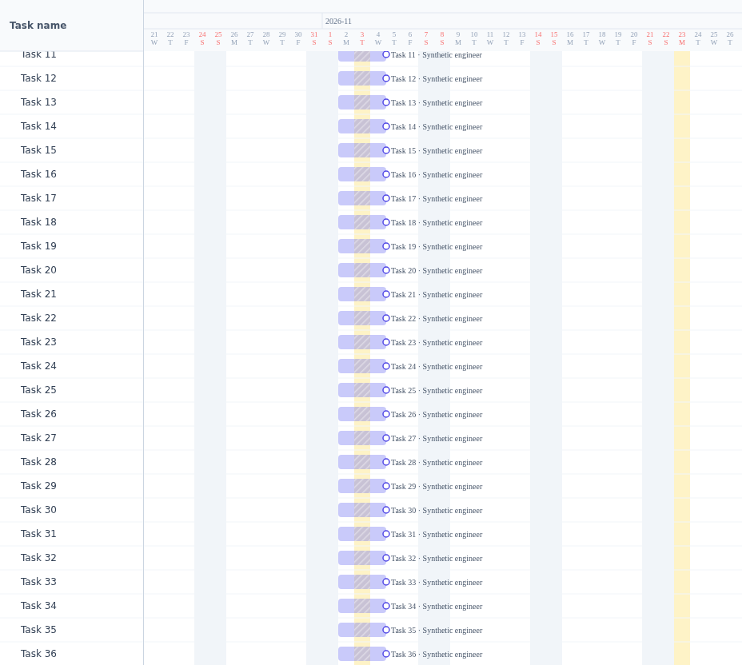
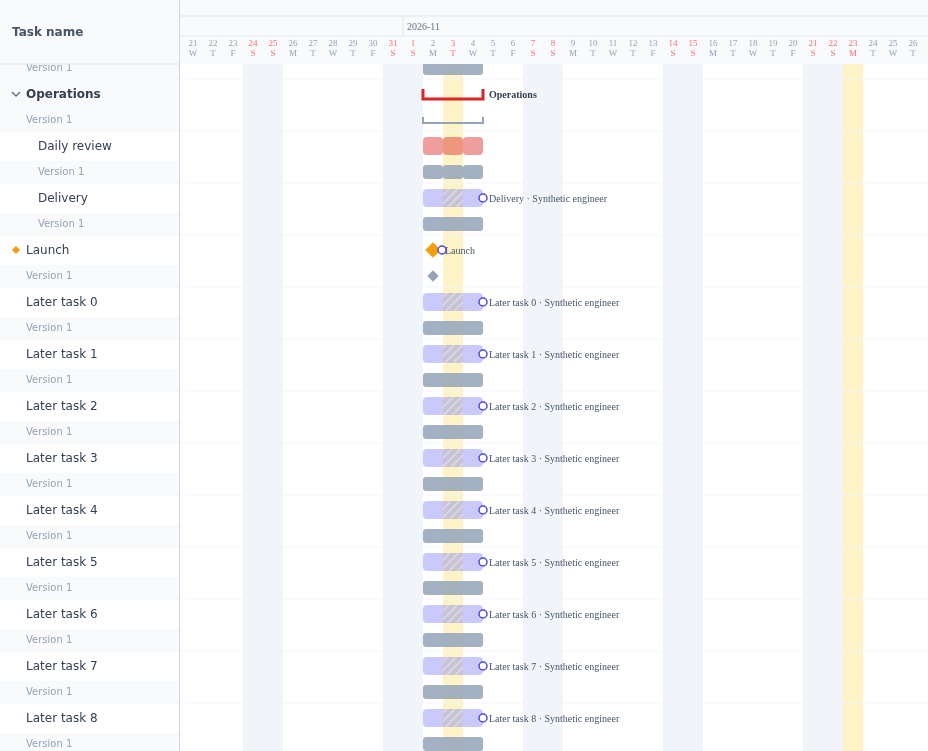
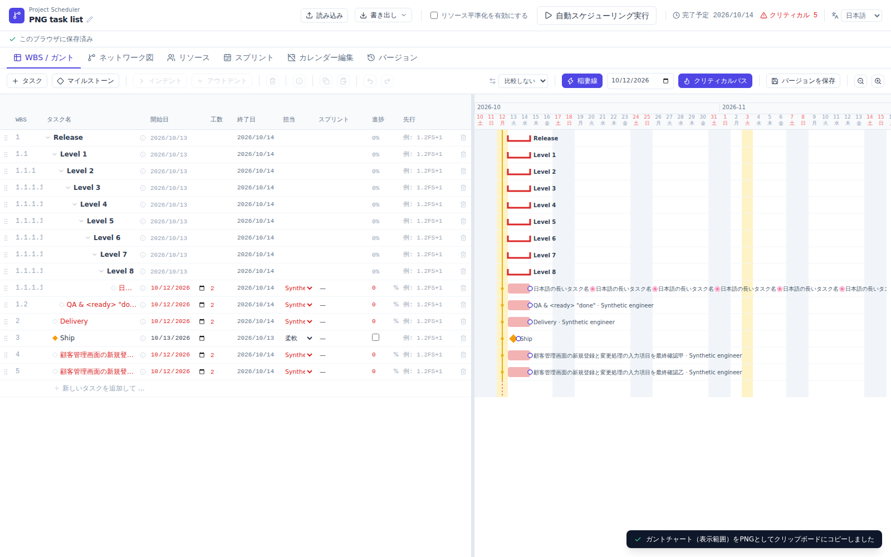

# Issue #62: PNG task-list evidence

These are actual PNGs exported by Project Scheduler in Chromium, plus an application screenshot. All fixtures are synthetic. The PNGs are not mockups or screenshots of a recreated design: the tests observe the production native-SVG-to-canvas export and decode the resulting PNG bytes.

## Captured source and checks

- Source commit: `69a435c9920e32fc0a22a6a92c2d76d2ec8936be`.
- [CI capture run](https://github.com/lhideki/project-scheduler/actions/runs/38126770883).
- Generated standalone HTML SHA-256: `d10886ac197fcda9fe10443cffebe942e3b2659d6a9a49b85e8988fa1a50e280`.
- Unit tests, production build, generated-file equality, Live Demo generation, and the full Chromium regression suite are checked in CI. Exact results, artifact identity, and image hashes are recorded in [verification.json](verification.json).

## Output examples

### Long Japanese names and deep hierarchy

The two ordinary long Japanese names share the same prefix and differ only in their final 甲/乙. Both remain complete across two lines, with 12 px text and 13 px line spacing inside the original 30 px row. Only the extreme repeated name is ellipsized. Indentation is capped while deeper levels keep a depth marker. The list is 280 CSS pixels wide here.

### Collapsed groups

Only the visible group and remaining tasks are included. The list contracts to 180 CSS pixels; hidden descendants and the new-task row are omitted.

### Recurring tasks and version comparison

One recurring series has one name row, with its separate occurrences aligned horizontally. The current 30 px lane and baseline 22 px lane keep the original task-pair height.

### Vertical and horizontal scrolling

The tests compare each exported name center with its actual bar center and compare decoded PNG bar pixels with their actual date-column background. The horizontally scrolled chart and compact list have independent clipping.

The first current lane is fully scrolled out; only its baseline is visible beneath the sticky header. Recurring occurrences, a milestone, and later task pairs remain aligned.

### Application view

The export leaves the live WBS column widths and scroll position unchanged. The compact list is created only in the exported image.

## Data safety and fallback

The tests compare stored task/plan/version data before and after exports. They also check native SVG escaping, absence of editing controls/columns, compact width, text bounds, row order, bottom cropping, and high-DPI output. Clipboard success, rejected writes, and unavailable clipboard are controlled in the test so the actual exported PNG can be compared byte-for-byte and pixel-for-pixel. The same rasterization code serves copy and download.

All 24 existing desktop/mobile visual-regression comparisons retain their existing thresholds and references. No masks or thresholds were relaxed.

## Review

[Codex found an unnecessary-ellipsis edge case](https://github.com/lhideki/project-scheduler/pull/63#discussion_r4240920179): a preferred word boundary could shorten a name that would fit across two lines. Commit `09a02e4` only prefers that boundary when the remainder fits and includes a regression. The thread was replied to and resolved after its CI passed. Copilot could not run because the requesting user's quota was exhausted; it is not counted as a completed code review.

## Verification limits

Chromium rasterization and simulated clipboard success/failure were tested. Native OS clipboard permission UI, Safari, and Firefox were not run. These images establish the tested export cases; they are not a general browser-compatibility claim.
