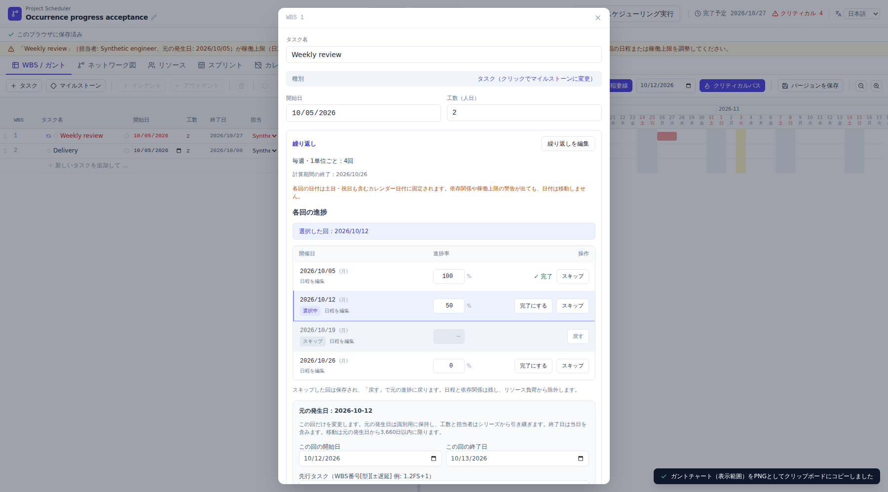
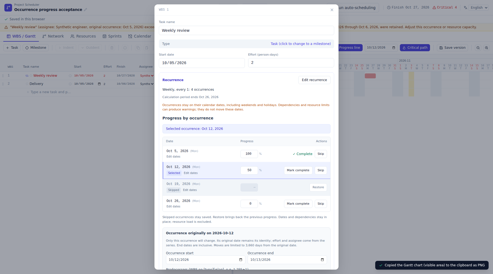
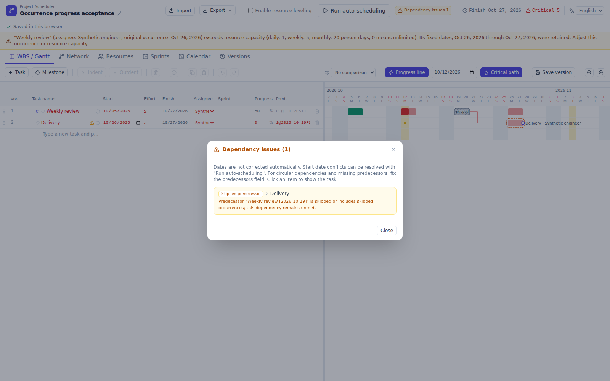

# Issue #64: per-occurrence progress and skip evidence

These are actual Chromium screenshots and a PNG exported by the production single-file application. All plans are synthetic. They are not mockups.

## Capture and verification

- Source: [49d50b81](https://github.com/lhideki/project-scheduler/commit/49d50b81dcc138c7613cd8846088329f13fde753).
- [Successful CI capture](https://github.com/lhideki/project-scheduler/actions/runs/38135511740/attempts/2): 748 unit tests and 118 browser tests, including 15 new acceptance tests.
- The browser suite passed without retries. The unchanged-head CI retry followed two unit-test timeouts on a slow first runner. Pixel thresholds, masks, reference images, and timeouts were not relaxed.
- All 24 existing desktop/mobile visual comparisons passed. Hashes, artifact identity, dimensions, and source-test names are in [verification.json](verification.json).

## Japanese detail view

Four weekly occurrences show 100%, 50%, skipped, and 0%. Opening the second Gantt bar highlights its original-date row. Progress commits on blur or Enter; Escape discards an unfinished numeric edit. Skip preserves the previous value and Restore brings it back. Date/dependency editing remains below the list, and resetting those fields preserves progress and skip state.

## English detail view

The series field is a read-only average of non-skipped occurrences within the saved calculation period. An all-skipped or empty series displays a dash. Extending the calculation period can change the average; the raw legacy progress stays an inheritance baseline rather than being overwritten by the average.

## Narrow mobile view

At 390 px, controls wrap within the modal instead of overflowing horizontally. The list and modal scroll to reach later rows and the footer. The tests operate Restore, numeric editing, completion, and Close, then reload and verify the saved state.

## Actual exported PNG

The production export keeps one task-name row and four occurrence bars. Tests inspect the observed native SVG and decode the actual resulting PNG: 100% and 50% fills have the expected widths, skipped and 0% bars have no progress fill, and the skipped bar includes a label and visibly varying hatch pixels. Clipboard rasterization is not replaced. Narrow zoom levels retain the hatch and accessible status when there is insufficient room for a text label.

## Retained dependency warning

Skipping removes resource load but preserves fixed dates and dependency edges. Specific skipped occurrences and a series containing skipped occurrences generate an unmet-predecessor warning. Restoration keeps the original progress and dates.

JSON, shared HTML, version restore, Undo/Redo, dormant overrides, finite-horizon edits, legacy progress, protected TSV writes, and resource-load changes are covered. Chromium was exercised; native OS clipboard permission dialogs, Safari, and Firefox were not run.
